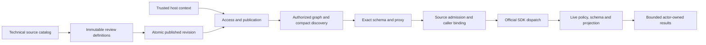

# ADR-0017: Governed publication, progressive discovery and execution

- Status: Accepted
- Date: 2026-10-12
- Scope: implementation-plan workstreams A–F and authorized graph retrieval

## Context

A reusable gateway must distinguish technical tool registration from permission to discover or execute a reviewed capability. Returning a complete tool catalog wastes model input; checking access only at invocation exposes private descriptions, schemas, graph evidence and asynchronous results. Mutable upstream schemas, caller credentials and catalog refresh introduce additional ownership races.

The [Uber gateway design](https://www.uber.com/gb/en/blog/designing-mcp-gateway/) motivates separation of identity, publication, progressive discovery and execution. We integrate those boundaries with the official MCP C# SDK and Microsoft.Extensions.AI rather than introducing another transport or application authentication system.

## Decision

Managed catalog mode requires a host-owned trusted-context provider, access policy and atomic definition store. Business/model context never supplies authentication. Immutable definitions preserve canonical IDs, raw upstream names, binding references, exact schemas, protocol metadata, reviewed permissions and hashes. Compare-and-swap publication validates the current technical catalog. Revocation remains effective across rollback and is checked again before dispatch, delivery, task access and stored-result reads.

Discovery filters publication and access before graph generation, ranking, expansion, rewrite and cache use. Generated graphs contain only visible tools. Applications supplying graphs must provide an independently owned projection through `IMcpGatewayAuthorizedGraphFactory`; the owner library's explicit subject/object/predicate projection prevents accidental private neighborhood traversal. SPARQL remains the primary schema-aware graph retrieval path, with token/vector signals supplementary. Lucene full-text search is explicit and uses the same authorized graph ownership.

Compact discovery pages enforce an exact serialized UTF-8 budget and omit schemas. Authorized schema lookup returns a complete schema with its hash/revision or a typed size-limit failure; schemas are never truncated. Schema-faithful AIFunction proxies execute canonical IDs with real arguments. Discovery-only SDK export exposes a fixed search/schema/invoke surface, plus a result reader when storage is registered.

Invocation distinguishes denied/invalid/rate-limited/cancelled/timed-out/unknown-completion/result-rejected outcomes. A host policy can approve output; strict JSON Pointer projection then produces one outward JSON representation. Output schemas validate approved complete JSON before projection. Oversized approved results may enter a bounded host-owned store. Handles require the original actor/tenant/authorization partition/policy revision, live read policy and publication hash. Stored metadata retains the originating managed instance's delivery cap so another reader cannot widen it.

Caller-bound SDK clients come from a host resolver and must match reviewed binding, audience, credential revision, scopes and live protocol schema. Managed HTTP and remote federation use a source-bound egress HttpClient that checks destination and resolved address, disables implicit redirects and leaves protocol/OAuth behavior with the official SDK. Federation requires explicit allowlisted endpoints and, in managed mode, caller-bound service leases; query and endpoint data are authorized before network dispatch.

Per-source admission has finite queues, configurable deadlines and circuit breaks. Mutating timeout/cancellation after dispatch reports unknown completion and never automatically retries. Uncooperative dispatch retains its client, scope, catalog and capacity until actual completion. Catalog refresh stages a complete validated replacement; failure retains the old snapshot. Notifications and periodic refresh share single-flight refresh. Retired readers and listeners release clients only after ownership drains.

Telemetry uses bounded outcome/operation/status labels, numeric histograms for sizes/counts, and no caller arguments, result content, endpoint or credential labels. An explicit host audit sink receives approved context and references under a configurable deadline. Full BenchmarkDotNet suites measure allocations; large catalog cases include permission partitions, source failures, concurrent discovery/schema/invocation and repeated refresh.

## Alternatives and trade-offs

Application-only authorization would leave reusable package entry points inconsistent. Consumer-side graph workarounds would duplicate an owned dependency defect. Both are rejected. Automatically trusting technical registrations or upstream read-only hints would permit unreviewed mutation and metadata disclosure; managed mode requires explicit host decisions.

Host-owned interfaces allow persistent/distributed implementations. Process-local implementations are opt-in, bounded, disposable and backed by DI-owned `IMemoryCache`. Managed partial graph construction prioritizes isolation over shared private graph traversal and remains an explicit benchmark cost. Default admission controllers cover startup sources plus explicitly configured future source IDs; hosts with an open dynamic source set supply their own bounded admission implementation.

Compatibility mode remains available, while managed mode fails closed. Exact schemas have a separate configurable maximum (64 KiB by default); compact summaries default to 16 KiB and responses to 64 KiB. Remote HTTP connection reuse is disabled in the egress client to re-evaluate caller/address policy at each connection; hosts must account for that cost.

The official dotNetRDF SPIN package is retained, but its public API cannot execute caller-controlled RDF SPIN commands with an offline/configurable library. Upstream [issue 911](https://github.com/dotnetrdf/dotnetrdf/issues/911) records the concrete blocker. No reflection bridge, fork or placeholder execution is shipped. Ontology, local SPARQL, Lucene full-text and explicitly bound federation are implemented.

## Implementation and verification

Implementation resides in the Catalog, Discovery, Invocation, Search and Hosting slices. Real SDK integration tests cover discovery-only export, caller-bound clients, scoped parallel callers, resource/prompt notifications, tasks, HTTP refresh and federation. Generated Markdown-LD fixtures cover graph projection and private metadata exclusion. Regression tests cover publication conflicts/drift/revocation, result representation/expiry/ownership, deadlines, queue revocation and source isolation.

[Delivery acceptance](../Features/GovernedExecutionDelivery.md), [architecture](../Architecture/Overview.md), [README](../../README.md) and [performance guide](../Performance/Benchmarks.md) describe the shipped contracts and verification evidence. Owner allocation repairs are delivered as public `ManagedCode.MarkdownLd.Kb 0.2.16` before consumption; a local package reference is not release evidence.
