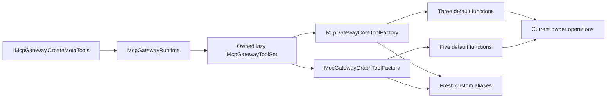

# ADR-0021: Bounded default meta-tool reuse

Status: Implemented
Date: 2026-11-03

## Context

Repeated `CreateTools` and `CreateGraphTools` calls materialized identical AI function metadata and JSON schemas. BenchmarkDotNet measured 1.60 and 2.84 KiB per call respectively. `IMcpGateway.CreateMetaTools` also created a new toolset for every call. The functions must retain the correct runtime owner, authorization flow and current catalog after reconfiguration.

## Decision

Each `McpGatewayToolSet` owns a core factory and a graph factory. Each factory lazily publishes one read-only list for its fixed default names. The runtime lazily retains its toolset for the facade. Custom aliases continue through normal name validation and fresh construction. Discovered proxies remain specific to each result and caller context.

The lists cannot be mutated through `IList<AITool>`. Function delegates execute current owner operations; no search results, catalog snapshots, authorization leases or discovered proxies are retained by this metadata cache. `Lazy<T>` publishes the default list once with the platform synchronization primitive. There is no static function cache or arbitrary-name dictionary. Each owning factory retains at most one default list. Separate DI and facade toolsets may both exist for a gateway.

## Alternatives and trade-offs

- Fresh construction on every request preserves semantics but repeats metadata allocation.
- A process-wide function cache would bind invokers across gateways and is rejected.
- A cache indexed by arbitrary names introduces unbounded retention and is rejected.
- Per-owner lazy metadata keeps a small fixed set alive until its owner is collected. The first creation still allocates. Invocation, graph search and custom aliases do not receive an allocation-free guarantee.

No public signature, protocol schema, persistence format or default search strategy changes. The existing private invocation delegate becomes internal for the cohesive factory extraction; its original signature and result pipeline remain intact.

## Verification methodology

`McpGatewayMetaToolReuseTests` invokes real registered tools through the returned functions, verifies two owners with the same canonical tool ID return their own output, rejects list mutation, checks custom names, and reconfigures the catalog while retaining old core and graph functions. The retained index-build function must report the new tool count and the retained invoke function must execute the replacement tool. Existing real SDK invocation, graph metadata, schema-budget, authorization, refresh and lifecycle suites remain required.

Use the root build, test, format, Roslynator and Coverlet commands. Coverage must remain above 85% overall and important touched paths must reach at least the mid-80s. BenchmarkDotNet `McpGatewayToolSetBenchmarks` includes both the direct toolset and public facade, plus the fresh discovered-proxy control. Clean repeated default access measured 0 B/op; tiny access timings do not measure end-to-end tool invocation. See the [release review](../Performance/RuntimePerformance-2026-11-03.md) for receipts, all fifteen iterations and limits.

## Delivery

Ship once in patch 2.3.4 together with the verified published Markdown-LD 0.3.0 dependency and the remaining stable dependency upgrades. No migration is required. A rollback uses the previous public package version without altering application data.
