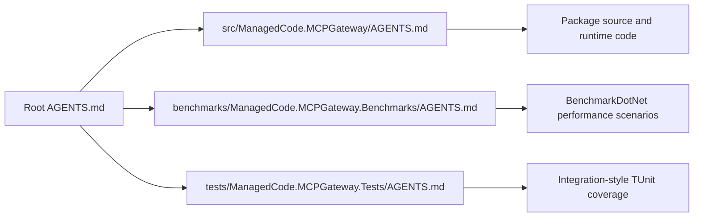
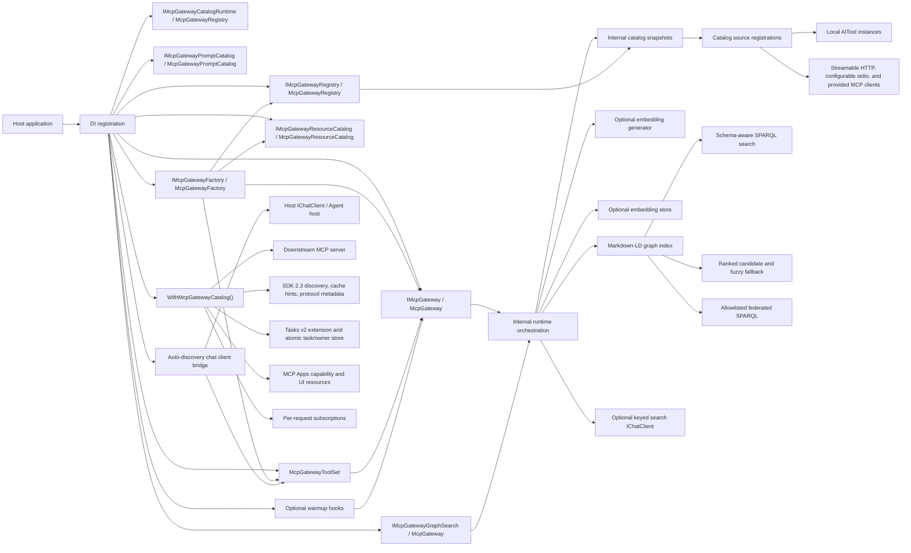
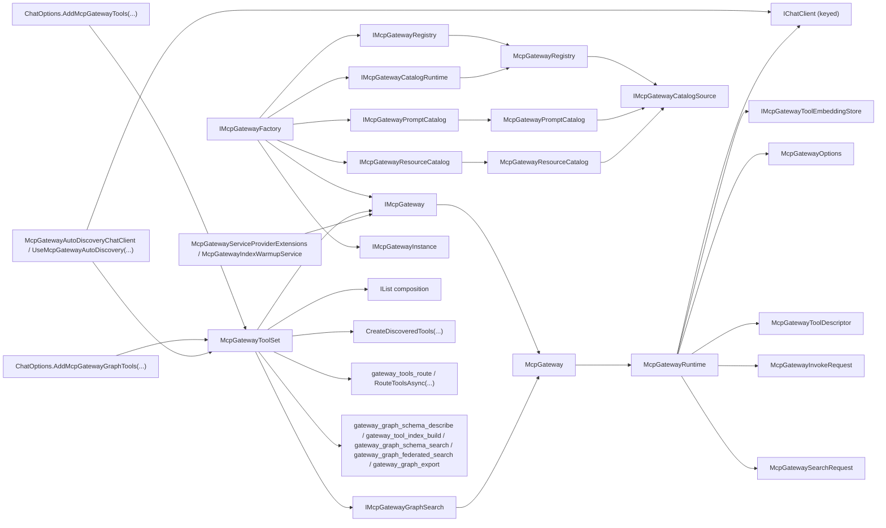
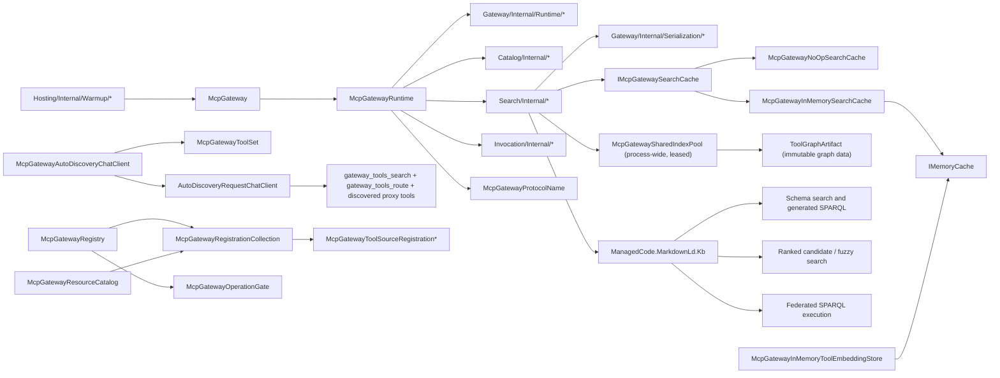

# Architecture Overview

## Scoping (read first)

This document is the module map for `ManagedCode.MCPGateway`.

In scope:

- package boundaries
- runtime collaboration between the public facade, registry, meta-tools, warmup hooks, and internal runtime
- dependency direction between public APIs, internal modules, and optional AI services
- benchmark project boundaries for repeatable performance and allocation measurements

Out of scope:

- feature-level ranking metrics
- test corpus details
- CI or release process

## Summary

`ManagedCode.MCPGateway` exposes seven public DI surfaces and one reusable tool-set surface:

- `IMcpGateway` for list/search/invoke
- `IMcpGatewayRegistry` for additive catalog registration
- `IMcpGatewayCatalogRuntime` for full in-memory catalog reset and reconfiguration
- `IMcpGatewayGraphSearch` for schema/profile inspection, schema-aware SPARQL graph search, explicit graph federation, graph evidence, and graph export
- `IMcpGatewayPromptCatalog` for aggregated MCP prompt listing, retrieval, and gateway-owned prompt composition
- `IMcpGatewayResourceCatalog` for aggregated MCP resource listing, template listing, and source-aware reads
- `IMcpGatewayFactory` for isolated custom gateway instances created from host DI
- `McpGatewayToolSet` for reusable search, route, and invoke meta-tools

`McpGateway` stays a thin facade over `McpGatewayRuntime`, which reads immutable catalog snapshots, coordinates default schema-aware Markdown-LD SPARQL graph search with gateway-built ranked candidate selection for large catalogs and ranked candidate/fuzzy graph fallback for focused noisy queries, vector-first `Auto` search with bounded Markdown-LD supplementation, or explicit embedding-first search, optionally rewrites queries through a keyed `IChatClient`, emits built-in .NET telemetry for build/search operations including vector token usage, calibrates user-facing search confidence before returning matches, and invokes local or MCP tools. Optional startup warmup is available through a service-provider extension or hosted background service without changing the lazy default.

Generated tool graphs are content-addressed. Gateway instances in one process that build an identical catalog share one immutable `ToolGraphArtifact` through the process-wide `McpGatewaySharedIndexPool<TIndex>`: concurrent builds coalesce, each runtime binds the shared graph to its own catalog entries and tool invokers, superseded graphs retire when their last lease is released, and at most two released graphs stay idle for reuse. File, custom-document, JSON-LD and authorized-projection graphs stay owned by their instance. [ADR-0019](../ADR/ADR-0019-content-addressed-tool-graph-index-reuse.md) records the fingerprint inputs, lifecycle and measurements.

File-backed graph initialization accepts exported `.jsonld` graphs through the Markdown-LD KnowledgeGraph loader, preserving RDF nodes and edges and binding canonical tool document URIs to the live callable catalog. Missing tool nodes fail initialization rather than silently regenerating the graph.

Index builds capture result metadata before snapshot publication. A newer catalog
may overtake an in-flight build; retirement of its stale graph must not invalidate
the completed build's metadata or overwrite the newer snapshot.

Embedded JSON-LD resources may also provide an explicit descriptor-to-node URI binding through `UseJsonLdGraphResource`. This preserves a host-owned graph's canonical URIs while the gateway retains tool identity, search, and invocation ownership. Relative, duplicate, and absent tool node bindings fail graph initialization; changing graph sources clears the binding.

`McpInMemorySession` is a Hosting utility for an SDK MCP server and client in one process. It owns the paired transports, server run task, cancellation, and disposal. The host still supplies its own `McpServerOptions`, service provider, authorization filters, and tool handlers. Product-specific graph vocabularies, tool selection, and authorization remain in the host.

Application-owned vocabularies configure `MarkdownLdGraphSchemaSearchProfile` for their actual tool types, text predicates, relationships, and facets. Runtime schema validation, schema description, and SPARQL search share that profile while retaining request-bounded result limits; a custom URI binding does not imply schema.org metadata.

Exact tool IDs and names are resolved before schema-query normalization for non-federated graph search. Their tool nodes bind subject `VALUES` in real schema-aware SPARQL on the existing graph, so shared prefixes and action-word filtering cannot displace a known tool with a sibling operation. Relationship evidence and related/next-step expansion use the same complete graph; search does not reconstruct a candidate graph. The owner selects focused URI triples through its official RDF indexes, with general RDF projection for non-URI identities.

Graph-specific search and indexing operations deliberately sit on `IMcpGatewayGraphSearch` and built-in graph tools instead of expanding the MCP-facing `IMcpGateway` contract. That surface exposes schema/profile inspection, generated SPARQL, graph evidence, explicit allowlisted federated SPARQL, mapped gateway tool matches, and runtime graph export while normal gateway search still returns the stable `McpGatewaySearchResult` and invocation still uses the same `ToolId` path. Non-federated direct graph tool search reuses the same candidate-backed schema path as normal graph search so agents cannot bypass the large-catalog optimization by calling `gateway_graph_schema_search`.

Configured schema profiles retain their complete graph semantics: candidate/type/facet/exclusion constraints make the SPARQL primary result authoritative in Hybrid mode, while profiles without explicit candidates can retrieve non-tool ontology nodes on large graphs. Automatic ranked tool pools apply to the default tool profile. Schema inspection includes candidate pools, excluded types, facets and multi-hop predicate paths. Federation compares normalized absolute endpoint URIs ordinally, preserving path/query casing; an empty selected endpoint set returns a specific diagnostic without executing a query. A real loopback SPARQL server test exercises the official remote client and RDF processor, not just local service bindings.

The graph owner supplies ontology/schema profiles, explicitly projected RDF graphs, Lucene full-text and caller-bound federated SPARQL. `IMcpGatewayGraphFullTextSearch` and `McpGatewayFullTextToolSet` expose index building and literal search over the current authorized graph. Managed remote SERVICE execution requires an allowlisted source binding, a validated caller lease and source-bound egress HTTP pipeline. Official dotNetRDF SPIN execution remains blocked by its public API; [upstream issue 911](https://github.com/dotnetrdf/dotnetrdf/issues/911) records the missing RDF-command/offline execution surface. No placeholder adapter is provided.

Managed mode separates technical registration from immutable reviewed publication through `IMcpGatewayCatalogPublication` and an atomic `IMcpGatewayCatalogDefinitionStore`. Trusted host context and `IMcpGatewayAccessPolicy` gate every exposed capability, including asynchronous notifications, tasks and stored results. Authorized generated/projected graphs filter private metadata before ranking and caches. Discovery-only export provides bounded summary pages, exact schema lookup and typed invocation through the official SDK.

Invocation owns source admission, deadlines, caller-bound SDK credentials and catalog leases through actual completion. Approved output schema validation and JSON Pointer projection precede delivery/storage. Bounded result handles retain actor/policy/definition and originating instance delivery limits; live revocation is rechecked on read. Targeted SDK/periodic refresh stages validated snapshots, coalesces concurrent requests and drains retired readers/listeners. Numeric measurements use histograms with bounded metric labels; host audit is explicit. [ADR-0017](../ADR/ADR-0017-governed-publication-discovery-and-execution.md) records the boundaries and trade-offs.

The package also keeps chat-client and agent integration generic: `McpGatewayToolSet` is the source of reusable `AITool` search, route, invoke, graph schema-describe, tool index-build, graph schema-search, graph federated-search, and graph export meta-tools plus compact discovery/exact-schema meta-tools, Lucene full-text tools and schema-faithful discovered proxy tools, `ChatOptions.AddMcpGatewayTools(...)` and `ChatOptions.AddMcpGatewayGraphTools(...)` remain the low-level bridges, and `McpGatewayAutoDiscoveryChatClient` plus `UseMcpGatewayAutoDiscovery(...)` provide the recommended staged host wrapper that starts with the gateway search/route/invoke tools and replaces the discovered proxy set on each new search result without introducing a hard host-framework dependency into the core package.

For MCP interoperability in the other direction, the package exposes `WithMcpGatewayCatalog()` as a server-builder extension. Hosts can re-export one aggregated catalog as a downstream MCP server with combined tools, prompts, and resources from multiple upstream sources plus gateway-owned prompts. The export uses the official SDK `2.3.0` core, Tasks, and Apps packages and leaves protocol negotiation to that SDK unless the application explicitly selects a version. Catalog loading does not impose another gateway-owned version check after a successful SDK handshake. SDK core owns negotiation, `server/discover`, per-request metadata, and cache-result decoration; Hosting owns source-aware completion, subscription, Tasks, and Apps coordination. Listeners are tracked by listen-request id, receive only their granted prompt/resource notifications, and release every upstream subscription on cancellation. Tool ids, downstream names, prompt ids, and exported resource names are canonical lowercase MCP-safe identifiers, while raw upstream names remain routing metadata. Resource URIs, including MCP App `_meta.ui.resourceUri` values, are rewritten into source-qualified gateway URIs. Arbitrary JSON Schema output shapes are preserved. Tasks use the SDK `IMcpTaskStore` adapter over `IMcpGatewayTaskStore`, which atomically stores task state with its trusted authorization/source binding. The bounded development store retains active work and applies result retention after terminal completion; a host store owns durable visibility and retention; upstream tools that require Tasks are retried through the SDK polling flow. Streamable HTTP is always stateless. By default the export binds to singleton gateway services, while `IMcpGatewayServerBindingResolver` supports request-specific gateway instances without forking the exported handler stack.

The repository now uses feature-first package slices for `Gateway`, `Discovery`, `Catalog`, `Search`, `Invocation`, `Prompts`, `Resources`, and `Hosting`. The durable policy decision behind that structure is captured in [`docs/ADR/ADR-0007-vertical-slice-package-organization.md`](../ADR/ADR-0007-vertical-slice-package-organization.md).

The benchmark project under `benchmarks/ManagedCode.MCPGateway.Benchmarks/` is intentionally outside the package source tree. It references the package project, runs BenchmarkDotNet in `Release`, and measures search, direct graph tool search, index-build, meta-tool allocations, 1k/5k/10k discovery/schema/invocation cycles, concurrent authorization partitions and repeated refresh without adding a runtime dependency to the NuGet package.

CI and release collect coverage from the built TUnit executable, map deterministic SourceLink `/_/` paths to the checkout through Coverlet's source-mapping file, and enforce at least 85% library line coverage. Empty coverage fails the gate. Release retains the coverage artifact, then packs and publishes without running or waiting for benchmarks. The complete benchmark suite runs in the independent CI workflow.

Documentation-only pushes to main do not rebuild or republish unchanged binaries; pull-request CI still runs the complete gates. Existing GitHub release artifacts remain immutable when a publication is repeated, matching NuGet's immutable package versions. Runtime, packaging and workflow changes continue to run the full benchmark suite in CI.

The CLI adapter in `src/ManagedCode.MCPGateway.Cli/` is packaged separately as the `mcpgateway` .NET tool. It uses the official MCP SDK to call a configured gateway endpoint for search, schema lookup, and invocation; its release workflow packs and publishes only that adapter. It adds no runtime dependency to the library.

## Native Local Protocol Results

Invocation treats an official CallToolResult returned by a local AIFunction as the same protocol result shape as an MCP source. The existing extraction path supplies structured content or text to output-schema validation, and the original protocol result occupies McpResult until the unchanged result policy or projection replaces it. Tool-level errors retain their native error classification without becoming invocation failures. The owning delivery stage measures the complete outward representation and retains its existing authorization, schema and byte limits. KeyLoad consumes this shipped native result contract; consumer-side serialization or schema bypass is not a repair.

## Governance Map

The solution uses root and project-local `AGENTS.md` files so agents can scope work without scanning the whole repository first.

- Root governance: [`AGENTS.md`](../../AGENTS.md)
- Package project guidance: [`src/ManagedCode.MCPGateway/AGENTS.md`](../../src/ManagedCode.MCPGateway/AGENTS.md)
- Test project guidance: [`tests/ManagedCode.MCPGateway.Tests/AGENTS.md`](../../tests/ManagedCode.MCPGateway.Tests/AGENTS.md)

## System And Module Map

## Interfaces And Contracts

## Key Classes And Types

## Module Index

- Gateway slice: [`src/ManagedCode.MCPGateway/Gateway/`](../../src/ManagedCode.MCPGateway/Gateway/) owns the public facade, factory, instance contracts, options, DI registration, runtime core, telemetry, and shared serialization helpers.
- Benchmarks project: [`benchmarks/ManagedCode.MCPGateway.Benchmarks/`](../../benchmarks/ManagedCode.MCPGateway.Benchmarks/) owns BenchmarkDotNet scenarios for graph search, cold, reused and parallel-host graph index builds, and reusable meta-tool allocation measurements, plus the `--profile` and `--profile-index` diagnostic workloads.
- Discovery slice: [`src/ManagedCode.MCPGateway/Discovery/`](../../src/ManagedCode.MCPGateway/Discovery/) owns reusable meta-tools, category-first routing, discovered-tool projection, auto-discovery chat integration, and discovery-specific registration/configuration.
- Catalog slice: [`src/ManagedCode.MCPGateway/Catalog/`](../../src/ManagedCode.MCPGateway/Catalog/) owns catalog contracts, models, mutable registration state, source adapters, descriptor creation, and index-building logic.
- Search slice: [`src/ManagedCode.MCPGateway/Search/`](../../src/ManagedCode.MCPGateway/Search/) owns search contracts, models, graph-search API contracts, runtime cache/store abstractions, process-local cache/store implementations, query normalization, graph schema/profile description, schema-aware SPARQL graph retrieval, ranked candidate/fuzzy graph support, explicit graph federation, graph export, vector ranking, and search confidence logic.
- Invocation slice: [`src/ManagedCode.MCPGateway/Invocation/`](../../src/ManagedCode.MCPGateway/Invocation/) owns invocation request/result contracts and runtime execution helpers.
- Prompts slice: [`src/ManagedCode.MCPGateway/Prompts/`](../../src/ManagedCode.MCPGateway/Prompts/) owns prompt contracts, gateway-owned prompt composition, prompt completion metadata, and the aggregated prompt catalog implementation.
- Resources slice: [`src/ManagedCode.MCPGateway/Resources/`](../../src/ManagedCode.MCPGateway/Resources/) owns resource contracts and the aggregated resource catalog implementation.
- Hosting slice: [`src/ManagedCode.MCPGateway/Hosting/`](../../src/ManagedCode.MCPGateway/Hosting/) owns current-protocol MCP server export, per-request subscription coordination, Tasks store composition, MCP Apps export metadata, completion proxying, forwarded notifications, and warmup integration.

## Dependency Rules

- Public contracts stay explicit, but each feature slice owns the contracts and internal helpers for its own behavior.
- `Gateway` is the orchestration slice only. It may delegate to catalog, search, invocation, prompts, discovery, and hosting collaborators, but it must not absorb their internal state or transport logic.
- `Catalog` owns mutable source registration state, source adapters, descriptor creation, and index-building orchestration.
- Gateway-created stdio sources use `McpGatewayStdioServerOptions` to preserve the SDK defaults while allowing hosts to disable inherited environment variables, provide an explicit environment allowlist, tune graceful shutdown, and observe stderr without replacing the official transport.
- `Search` owns query shaping, ranking, graph schema/profile description, schema-aware SPARQL graph retrieval, ranked candidate/fuzzy graph support, explicit federated graph retrieval, graph export, vector retrieval, confidence calibration, and process-local cache/store implementations.
- `Invocation` owns tool-target resolution, argument preparation, invocation, and result normalization.
- `Prompts` owns prompt listing, prompt retrieval, gateway-owned prompt composition, and explicit prompt-overlay behavior for registered MCP sources.
- `Resources` owns resource listing, resource-template listing, resource reads, and gateway-owned URI rewriting for downstream MCP export.
- `Discovery` owns model-visible gateway tool exposure, category-first routing, and staged auto-discovery chat flow.
- `Hosting` owns downstream MCP server export, completion proxying, per-request subscription forwarding, Tasks composition, MCP Apps URI rewriting, and optional warmup integration. SDK core remains the owner of discovery, per-request protocol metadata, result/cache decoration, and transport semantics.
- Streamable HTTP is always stateless. HTTP listeners must not be represented as notification-capable; current-protocol listener state exists only for transports that can keep the request alive.
- SDK task protocol state and its gateway authorization binding share `IMcpGatewayTaskStore`. The SDK-facing adapter reads stored ownership on every access; it has no process-local ownership registry. The bounded default uses MemoryCache with terminal-result retention, while durable/distributed persistence and execution remain host-owned. See ADR-0020.
- Optional AI services such as embedding generators and query-normalization chat clients must stay outside the package core and be resolved through DI service keys rather than hardwired provider code.
- Chat-client and agent integrations must stay `AITool`-centric in the core package. Host-specific frameworks may consume those tools, but the base package should not take a hard dependency on a specific agent host unless that becomes an explicit product decision.
- `McpGatewayAutoDiscoveryChatClient` may orchestrate tool visibility for host chat loops, but it must stay generic over `IChatClient` and must not take a dependency on a specific agent framework.
- The recommended staged host flow is: advertise the gateway search, route, and invoke meta-tools first, then project only the latest search matches as direct proxy tools, then replace that discovered set on the next search result.
- Embedding support must stay optional and isolated behind `IMcpGatewayToolEmbeddingStore` and embedding-generator abstractions.
- Process-local runtime search caching must stay behind `IMcpGatewaySearchCache`, with a no-op default and an explicit opt-in implementation over host-owned `IMemoryCache` for hosts that want local reuse.
- Generated tool graph reuse is the one process-wide store: `McpGatewaySharedIndexPool<TIndex>` holds only immutable graph-derived data keyed by a content fingerprint, reference counts it, bounds idle retention, retires and disposes deterministically, and never holds tool invokers, clients, services or caller data.
- The built-in process-local embedding store may depend on host-owned `IMemoryCache`, but it must not create hidden private caches; cross-instance persistence and cache replication must stay behind host-provided `IMcpGatewayToolEmbeddingStore` implementations.
- Markdown-LD graph search is the default internal retrieval strategy. It may depend on `ManagedCode.MarkdownLd.Kb`, uses schema-aware SPARQL as the primary graph path in hybrid/schema-aware mode, uses gateway-built ranked candidate selection to bound large-catalog schema search, uses ranked candidate/fuzzy graph search only as focused hybrid support or fallback, still returns the same public `McpGatewaySearchMatch` contracts, calibrates user-facing confidence at the gateway layer, and must not create a separate invocation surface.
- Graph-specific schema/profile inspection, evidence, generated SPARQL, explicit federated search, explicit index-build tooling, and runtime graph export belong to `IMcpGatewayGraphSearch` and `McpGatewayToolSet` graph tools, not to the MCP-facing `IMcpGateway` facade.
- Federated graph search must use explicit configured endpoint allowlists, local graph bindings, and the `McpGatewayOptions.MarkdownLdFederatedSparqlQueryTimeout` `TimeSpan` option; the runtime must not perform hidden remote SPARQL discovery from the normal search path.
- Markdown-LD graph sources may be generated from the live catalog at index build time, loaded from a file-system path, or provided through a host-supplied document factory configured in `McpGatewayOptions`. All modes must still map graph documents back to the current catalog before returning matches.
- Tool metadata used for search enrichment must stay explicit and developer-controlled through registration hints or tool annotations; multilingual improvement should come from metadata plus scoring, not from one-off hardcoded phrase rules in runtime code.
- Warmup remains optional. The package must work correctly with lazy indexing and must not require manual initialization for every host.
- Recoverable runtime failures use fixed package-owned diagnostic categories. Exception objects, exception/provider messages, caller queries/arguments, and endpoint text MUST NOT be exposed through gateway results, diagnostics, or logs; caller cancellation keeps its existing propagation behavior.

## Key Decisions (ADRs)

- [ADR-0017: Governed publication, discovery and execution](../ADR/ADR-0017-governed-publication-discovery-and-execution.md)

- [`docs/ADR/ADR-0001-runtime-boundaries-and-index-lifecycle.md`](../ADR/ADR-0001-runtime-boundaries-and-index-lifecycle.md): documents the public/runtime/catalog split, DI boundaries, lazy indexing, cancellation-aware single-flight builds, and optional warmup hooks.
- [`docs/ADR/ADR-0002-search-ranking-and-query-normalization.md`](../ADR/ADR-0002-search-ranking-and-query-normalization.md): documents optional English query normalization and the current search strategy boundaries.
- [`docs/ADR/ADR-0003-reusable-chat-client-and-agent-tool-modules.md`](../ADR/ADR-0003-reusable-chat-client-and-agent-tool-modules.md): documents why chat-client and agent integrations stay generic around reusable `AITool` modules instead of adding a hard host-framework dependency to the core package.
- [`docs/ADR/ADR-0004-process-local-embedding-store-uses-imemorycache.md`](../ADR/ADR-0004-process-local-embedding-store-uses-imemorycache.md): documents why the built-in process-local embedding cache uses `IMemoryCache` and why durable/distributed caching remains a host responsibility.
- [`docs/ADR/ADR-0005-markdown-ld-graph-search-for-tool-retrieval.md`](../ADR/ADR-0005-markdown-ld-graph-search-for-tool-retrieval.md): documents the default Markdown-LD graph retrieval path, file-system graph sources, and opt-in vector fallback behavior.
- [`docs/ADR/ADR-0006-vector-first-auto-search-and-runtime-telemetry.md`](../ADR/ADR-0006-vector-first-auto-search-and-runtime-telemetry.md): documents vector-first `Auto`, bounded graph supplementation, runtime telemetry, deterministic performance regression coverage, and full BenchmarkDotNet benchmarks.
- [`docs/ADR/ADR-0007-vertical-slice-package-organization.md`](../ADR/ADR-0007-vertical-slice-package-organization.md): documents the feature-first foldering policy and the incremental migration away from large technical buckets.
- [`docs/ADR/ADR-0008-aggregated-resource-catalog-and-gateway-uri-rewriting.md`](../ADR/ADR-0008-aggregated-resource-catalog-and-gateway-uri-rewriting.md): documents the aggregated MCP resource catalog and the gateway-owned URI rewrite required for unambiguous downstream resource reads.
- [`docs/ADR/ADR-0013-mcp-safe-canonical-protocol-names.md`](../ADR/ADR-0013-mcp-safe-canonical-protocol-names.md): documents canonical lowercase MCP-safe names for gateway tool ids, downstream tool names, prompts, exported resource names, and case-insensitive resolution.
- [`docs/ADR/ADR-0011-gateway-owned-prompt-composition-and-list-change-forwarding.md`](../ADR/ADR-0011-gateway-owned-prompt-composition-and-list-change-forwarding.md): documents explicit gateway-owned prompt composition, prompt overlays, prompt argument completion, and forwarded prompt list-change notifications.
- [`docs/ADR/ADR-0012-schema-aware-sparql-graph-search.md`](../ADR/ADR-0012-schema-aware-sparql-graph-search.md): documents schema-aware SPARQL as the primary Markdown-LD graph retrieval path, schema/profile and index-build tooling, explicit federated graph search, graph export, and the `IMcpGatewayGraphSearch` boundary.
- [`docs/ADR/ADR-0014-mcp-sdk-2-protocol-and-extension-adoption.md`](../ADR/ADR-0014-mcp-sdk-2-protocol-and-extension-adoption.md): documents SDK-owned protocol negotiation, Streamable HTTP, per-request subscriptions, Tasks, MCP Apps, arbitrary output schemas, and Markdown-LD `0.2.8` adoption.
- [`docs/ADR/ADR-0016-safe-runtime-diagnostics.md`](../ADR/ADR-0016-safe-runtime-diagnostics.md): documents closed, fixed diagnostics for recoverable failures and the prohibition on exposing exception or request/provider text.
- [`docs/ADR/ADR-0019-content-addressed-tool-graph-index-reuse.md`](../ADR/ADR-0019-content-addressed-tool-graph-index-reuse.md): documents process-wide reuse of identical generated tool graphs, its fingerprint, lease/eviction lifecycle and ownership exception.

## Related Docs

- [`README.md`](../../README.md)
- [`docs/Performance/Benchmarks.md`](../Performance/Benchmarks.md)
- [`docs/ADR/ADR-0001-runtime-boundaries-and-index-lifecycle.md`](../ADR/ADR-0001-runtime-boundaries-and-index-lifecycle.md)
- [`docs/ADR/ADR-0002-search-ranking-and-query-normalization.md`](../ADR/ADR-0002-search-ranking-and-query-normalization.md)
- [`docs/ADR/ADR-0003-reusable-chat-client-and-agent-tool-modules.md`](../ADR/ADR-0003-reusable-chat-client-and-agent-tool-modules.md)
- [`docs/ADR/ADR-0004-process-local-embedding-store-uses-imemorycache.md`](../ADR/ADR-0004-process-local-embedding-store-uses-imemorycache.md)
- [`docs/ADR/ADR-0005-markdown-ld-graph-search-for-tool-retrieval.md`](../ADR/ADR-0005-markdown-ld-graph-search-for-tool-retrieval.md)
- [`docs/ADR/ADR-0006-vector-first-auto-search-and-runtime-telemetry.md`](../ADR/ADR-0006-vector-first-auto-search-and-runtime-telemetry.md)
- [`docs/ADR/ADR-0007-vertical-slice-package-organization.md`](../ADR/ADR-0007-vertical-slice-package-organization.md)
- [`docs/ADR/ADR-0008-aggregated-resource-catalog-and-gateway-uri-rewriting.md`](../ADR/ADR-0008-aggregated-resource-catalog-and-gateway-uri-rewriting.md)
- [`docs/ADR/ADR-0011-gateway-owned-prompt-composition-and-list-change-forwarding.md`](../ADR/ADR-0011-gateway-owned-prompt-composition-and-list-change-forwarding.md)
- [`docs/ADR/ADR-0014-mcp-sdk-2-protocol-and-extension-adoption.md`](../ADR/ADR-0014-mcp-sdk-2-protocol-and-extension-adoption.md)
- [`docs/ADR/ADR-0012-schema-aware-sparql-graph-search.md`](../ADR/ADR-0012-schema-aware-sparql-graph-search.md)
- [`docs/Features/SearchQueryNormalizationAndRanking.md`](../Features/SearchQueryNormalizationAndRanking.md)
- [`docs/Features/SafeRuntimeDiagnostics.md`](../Features/SafeRuntimeDiagnostics.md)
- [`docs/Features/AutoVectorFirstSearchAndPerformance.md`](../Features/AutoVectorFirstSearchAndPerformance.md)
- [`AGENTS.md`](../../AGENTS.md)
- [`src/ManagedCode.MCPGateway/AGENTS.md`](../../src/ManagedCode.MCPGateway/AGENTS.md)
- [`tests/ManagedCode.MCPGateway.Tests/AGENTS.md`](../../tests/ManagedCode.MCPGateway.Tests/AGENTS.md)

JSON-LD graph sources can be filesystem exports or embedded assembly resources (`UseJsonLdGraphResource`). Both load the persisted graph directly and validate tool bindings; resource loading never extracts a file or regenerates a missing graph. JSON document bundles continue through the existing document pipeline.

Hybrid search retains exact tool identity matches from schema search before considering lexical candidate ranking, so a broader candidate cannot evict a requested tool name.

HTTP sources may explicitly retain source-qualified canonical tool IDs for durable host selections. The catalog naming owner applies this before discovery, export and invocation; adding an identically named method on another server does not change existing IDs.

## Native JSON request maps

Tool invocation and access requests, prompt rendering and search/route context carry caller-authored JSON through `JsonElement` maps. Invocation copies and owns those elements before validation and execution; MCP adapters copy JSON elements at the protocol boundary. Only actual external SDK invocation parameters box JSON elements into the SDK object-valued ABI. Trusted `McpGatewayExecutionContext` remains separate from model-supplied context. See [ADR-0018](../ADR/ADR-0018-native-json-request-maps.md).
