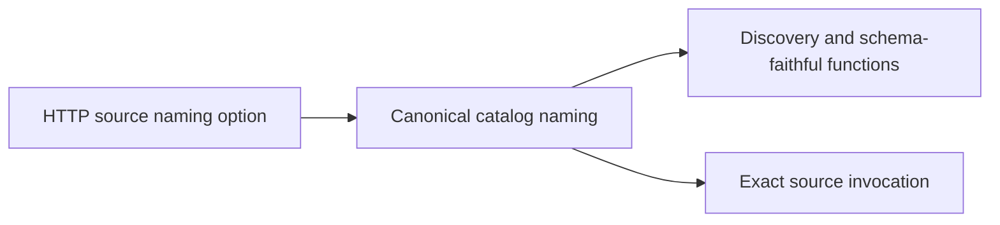

# Source-qualified HTTP tool identity

Persisted host selections need the same canonical tool ID before and after another server introduces an identical upstream method name. `McpGatewayHttpServerOptions.UseSourceQualifiedToolIds` opts an HTTP source into source qualification from its first discovery. Default callers keep the existing naming contract. The registration snapshot retains the setting; the native catalog naming owner applies the existing MCP-safe normalization and name-length contract. Descriptors, direct schema-faithful functions, search, MCP export and invocation use the resulting canonical ID.

`McpGatewaySourceQualifiedHttpIdentityTests` starts two real SDK HTTP servers with identical method names, retains the first discovered ID while adding the second source, and invokes the original ID against its original source.
